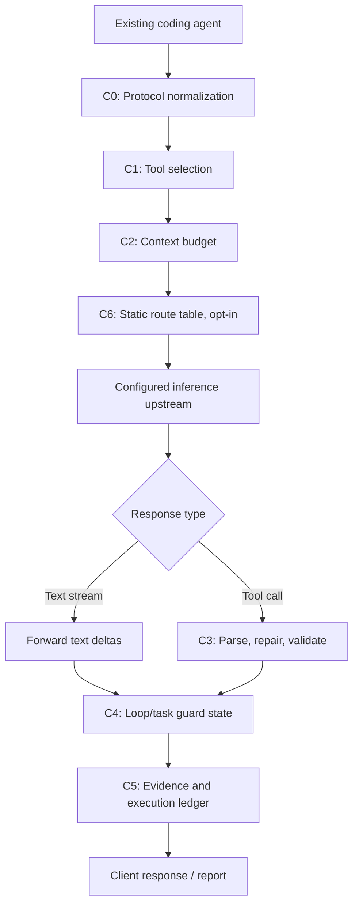

# Pocket Harness — Design & Implementation Specification

**Document revision:** v0.2-design  
**Date:** 2026-10-21  
**Status:** Proposed specification; implementation and benchmark results are not yet claimed  
**Project:** Yato-Works / Pocket Harness  
**Owner:** Eli

> **One-line promise:** Make coding agents more reliable with constrained local models by deterministically managing context, tool calls, and repeated failures—without requiring the agent itself to be rewritten.

---

## 0. Scope boundary: this document is Pocket Harness only

Pocket Harness is a **request/response proxy and execution trace system** placed between an existing coding agent and an inference endpoint. Its job is to make the agent's interaction with the model more robust and auditable.

This specification does **not** define or include Stream Agent's separate research direction: remote/on-demand model-weight streaming, Hugging Face Range downloads, SSD-budget allocation, shared multi-model weight caches, layer-wise weight loading, or the use of very large streamed models as background subagents. Those concepts must remain in a separate design document. Pocket Harness may eventually accept a remote inference endpoint like any other upstream, but it will not implement model-weight delivery or a model runtime.

## 1. Executive summary

Pocket Harness is a local-first, deterministic proxy intended to improve coding-task completion with small or resource-constrained models. It does not train models and does not use a separate LLM to summarize context, judge success, or choose interventions. Its core logic is inspectable transformation code, schema validation, trace-derived state, and bounded recovery behavior.

The initial target is a single local inference server and a coding agent configured to use an OpenAI-compatible endpoint. The first practical client integrations are **Cline and OpenCode**, because both document support for configurable OpenAI-compatible endpoints/custom base URLs. Claude Code compatibility is deferred until a dedicated adapter and versioned conformance tests exist; it must not be implied merely because an Anthropic-compatible endpoint can be configured.

The project will establish its value with a controlled local benchmark. Optional cloud APIs, free-model endpoints, static multi-model routing, and cost tracking are extensions—not part of the primary benchmark claim. A configurable route table may map explicit model IDs to explicitly configured upstreams, but Pocket Harness will not silently infer a task's difficulty, dynamically choose models, or fall back to a paid provider unless a user deliberately opts in.

### 1.0.1 Revision notes from the initial v0.1 draft

This revision incorporates the design decisions reached after the original draft:

- Cline and OpenCode move to the front of the compatibility queue; Claude Code is deferred until a dedicated protocol adapter and conformance suite exist.
- C5 becomes mandatory for evidence and a minimal execution ledger; inserting ledger text into every model request remains a separately evaluated option.
- R (provider/rate-limit/transport rejection) is separated from model-task failures so external availability does not corrupt the local efficacy gate.
- Static model routing is opt-in and later than the single-upstream baseline; dynamic task routing and implicit paid fallback remain out of scope.
- Actual upstream/model IDs and request retries are recorded for every relevant run.
- Replay is split from metadata-only logging, because hashes alone cannot reconstruct a request body.
- Existing client compaction and loop safeguards are treated as possible overlaps, not as gaps Pocket Harness can automatically claim to solve.

### 1.1 Primary goals

1. Improve end-to-end task completion for coding agents using constrained local models.
2. Preserve the client's API contract and require as little agent configuration change as practical—ideally only a Base URL and compatible model configuration.
3. Make proxy transformations deterministic for a fixed request, configuration, and version.
4. Record enough evidence to explain which transformation occurred, why it occurred, which upstream actually handled the request, and how the run ended.
5. Measure improvements against a reproducible baseline before making performance claims.
6. Remain local-first: no telemetry, no mandatory account, and no external service required for the core path.

### 1.2 Non-goals

- Training, fine-tuning, or making the underlying model intrinsically more intelligent.
- Building a general-purpose agent UI or a replacement for Cline, OpenCode, or Claude Code.
- A generic dynamic model gateway, load balancer, or learned task router.
- Optimizing the core product around paid cloud inference.
- Hidden/automatic uploading of prompts, code, logs, or telemetry.
- Acting as a security sandbox or replacing the client's tool permissions.
- Serving, downloading, caching, or streaming model weights. (That belongs to Stream Agent, separately.)

### 1.3 Design principles

- **Deterministic transformation:** identical normalized input + identical config + identical implementation version must yield identical proxy output.
- **Fail conservatively:** do not guess semantic intent. If an output cannot be safely repaired, preserve the evidence and report the failure.
- **No invisible model calls:** no helper-model calls for summarization, scoring, or deciding whether a task is done. Any permitted repair retry is explicit, bounded, logged, and counted as a model request.
- **Evidence before claims:** distinguish measured results, hypotheses, and estimates in code, reports, and release notes.
- **Client compatibility is a contract:** unsupported fields or stream events must be handled explicitly and tested, not silently assumed to work.
- **Privacy by design:** metadata logging is distinct from storing replayable prompt bodies. Full local replay is opt-in because the captured context can contain source code and secrets.
- **No automatic paid fallback:** remote routes never switch to a paid model by accident.

## 2. Product contract and success criteria

The numbers below are **proposed acceptance targets**, not achieved results.

| Metric | Proposed target | Measurement |
|---|---:|---|
| Held-out task completion | At least +30 percentage points vs. baseline to pass the main continuation gate | Test command, repository constraints, and task result |
| Broken tool-call rate | At most half of baseline | Count schema-invalid or unusable tool calls in traces |
| First-time setup | 10 minutes or less for a new tester | Observe at least 3 independent testers |
| Proxy overhead | p95 ≤ 50 ms per request for local transformation work, excluding model inference and network wait | Monotonic-clock measurements in trace |
| Reproducibility | Same transformed-request hash when replaying the same captured input with the same version/config | `pocket replay` |
| Privacy | No telemetry and no outbound connections except configured upstreams | Test network behavior and inspect code/config |

Do not report a completion-rate improvement without publishing the denominator, individual task outcomes, model/runtime configuration, and failed examples. If the evidence is weaker than the target, report it plainly.

## 3. Problem hypothesis and failure taxonomy

The central hypothesis is that some coding-agent failures are caused not only by model capability, but by the shape and size of the request, malformed tool calls, excessive tool choices, repeated failure cycles, and missing execution state. The first benchmark must determine how often these failure modes actually occur in the chosen environment.

| Code | Failure mode | Operational definition | Candidate intervention |
|---|---|---|---|
| **O** | Context overflow / request too large | Input exceeds the configured budget or the upstream rejects it as too long | C2 ContextBudgeter; normalize provider errors |
| **M** | Malformed or schema-invalid tool call | Tool name/arguments cannot be validated against the original tool schema | C3 ToolCallRepair |
| **L** | Loop / unproductive repetition | A deterministic repeated-call or repeated-error rule is triggered | C4 LoopGuard |
| **S** | Stopped before completion | Step, wall-clock, or configured task budget is exhausted | C4 stop escalation and reporting |
| **W** | Wrong semantic edit / reasoning failure | Task fails and none of O/M/L/S/R explains the failure | Normally not fixable by a deterministic proxy; use to evaluate project viability |
| **R** | Upstream rejection / rate limit / provider outage | 429/rate limit, quota rejection, authentication failure, unsupported optional capability/parameter, provider unavailable, or a streamed terminal error | Capability checks, bounded transport policy, clear error reporting |

**R must remain separate from model-quality failures.** It is excluded from the primary local-model efficacy denominator when it is caused by the upstream service, and is reported separately. Otherwise, provider availability could distort the decision to continue or abandon the project. Authentication errors should not be retried as if they were rate limits.

The proxy cannot reliably fix W without adding a reasoning system or another inference call, which is outside the core design. If the majority of local baseline failures are W, revisit the product hypothesis rather than disguising the result.

## 4. Supported surface and compatibility strategy

### 4.1 Initial interface

- **Client-facing API for v0.1:** OpenAI-compatible `POST /v1/chat/completions` with streaming support; implement only the other endpoints required by the selected clients and `doctor` checks.
- **Upstream API for v0.1:** OpenAI-compatible chat completions, initially tested with local servers such as Ollama, llama.cpp server, and LM Studio. Feature support varies by server and model; maintain a tested capability profile rather than assuming full OpenAI API parity.
- **First clients:** Cline and OpenCode. Both provide configuration paths for custom OpenAI-compatible endpoints/base URLs in their current documentation.
- **Deferred client adapter:** Anthropic Messages API / Claude Code compatibility. A separate adapter must account for request fields, model IDs, event/stream formats, context handling, and client-specific retries. Do not advertise compatibility until a conformance suite passes for explicitly listed versions.

The proxy should normalize supported incoming requests into one internal representation, then apply the same transformation pipeline regardless of client. Client-API adapters translate only at the edges.

### 4.2 C0 — Request Normalizer and Capability Profile

C0 validates the incoming request and maps supported fields to a canonical internal schema. It must:

- Validate basic types and required fields.
- Keep a list of fields supported by each configured upstream/model profile.
- Preserve supported values exactly unless a documented normalizer is required.
- When an optional field is unsupported, follow the configured policy: `error` (strict) or `omit-and-warn`; default to `omit-and-warn` only for fields explicitly marked optional.
- Never silently remove messages, tools, `tool_choice`, or other semantically critical fields.
- Record every dropped/translated field and reason.
- Never log API keys or authorization headers.

For unknown clients or incompatible protocols, fail with a clear error rather than attempting speculative translation.

### 4.3 Streaming contract

- Forward ordinary text deltas as they arrive.
- Buffer tool-call deltas until the tool call is complete enough to parse and validate. Only then emit the reconstructed tool call in the client protocol.
- Preserve tool-call IDs, indices, finish reasons, usage fields when available, and event ordering expected by the client.
- If an upstream failure occurs **before** any response bytes are sent, the configured bounded retry policy may apply.
- If a failure occurs **after** streaming began, do not transparently restart the request and splice a second generation into the first. Terminate the stream using the best-supported error representation, mark it as R, and retain the upstream diagnostic.
- Keep-alive/ping behavior must be tested with slow upstreams. Never strip heartbeat events without proving the client remains connected.

A stream compatibility test suite is a release blocker, not a polish task.

## 5. Architecture



C5 observes the entire pipeline. Loop state is derived from the conversation and tool-call/result history; no separate LLM is used. The internal pipeline should be implemented as small, testable functions with explicit inputs and outputs. Persistent state is used only for run records, cache/replay references, and session checkpoints—not for hidden model decisions.

### 5.1 Technology choices

| Area | Initial choice | Rationale / condition |
|---|---|---|
| Language | Python 3.11+ | Existing project/tooling familiarity and rapid iteration |
| HTTP server | Starlette + Uvicorn | Async request and streaming support |
| Upstream HTTP | httpx, async | Streaming, timeouts, connection pooling |
| Validation | Pydantic v2 + `jsonschema` | Typed canonical request model and JSON Schema validation |
| State / evidence | SQLite + JSONL + content-addressed local blobs | No extra long-running service; trace inspection and replay |
| Tests | pytest + Hypothesis | Unit, regression, and invariant/property tests |
| Packaging | `uv` workflow; PyPI after namespace availability is checked | Easy installation; package/repository names remain to be verified |

These are proposed choices. Re-evaluate only when a measured bottleneck or required compatibility gap justifies it.

## 6. Core components

All components must be deterministic for a fixed input and configuration. Any state-dependent decision must use a recorded, reproducible state snapshot.

### C1 — ToolSelector

Choose a smaller subset of the tools to expose in each request while preserving the original tool definitions as the authority for validation.

Initial behavior:

- `pinned` tools are always included (example: read/search/edit/test command tools selected by the client profile).
- Rank remaining tools using deterministic signals: recent use and lexical relevance (BM25 or a similarly deterministic scorer) from the current user request and recent tool results.
- Default maximum: pinned tools plus 6 selected tools. If pinned tools already exceed the cap, preserve them and emit a warning rather than silently dropping them.
- Truncate long tool descriptions deterministically (initial proposal: first meaningful line and at most 200 characters); **never rewrite the argument schema**.
- Use sticky selection: keep a selected tool available until it has been unused for 5 turns, to reduce prompt churn and avoid needless cache invalidation.
- If the model calls a hidden tool that existed in the original client-supplied tool list, do not treat the hiding itself as an authorization denial. Validate it against the original schema and the client's actual permission model. Tool selection is not a security boundary.
- Never invent new tools or alter a destructive tool's permissions.

### C2 — ContextBudgeter

C2 enforces a request budget based on the configured context window, reserved output tokens, and safety margin.

Initial thresholds (tunable after measurement):

- Start compression when estimated input exceeds 85% of the usable budget.
- Compress in one pass toward 70% of the usable budget instead of gradually changing the request on every turn.
- Prefer a provider's tokenizer/count endpoint when available; otherwise use the exact model tokenizer if installed; finally use a conservative estimator with a logged confidence/source label.
- Context length must come from explicit configuration or verified model metadata. If unknown, `doctor` must show that uncertainty and the user must be able to set the value manually. Never silently assume a large context window.

Compression sequence:

1. **Deduplicate tool output:** replace old identical results with a reference stub containing a content hash/ID.
2. **Clip oversized tool output:** retain a deterministic head/tail window, byte/token sizes, and a stable reference ID to the omitted content.
3. **Reduce old tool-result resolution:** replace eligible older outputs with deterministic metadata (tool/command when known, exit status if the result provides it, byte count, head/tail excerpt, content hash). Do not invent a natural-language summary.
4. **Omit oldest complete exchanges** only if the request still exceeds the budget. Keep tool-call/result pairs structurally valid. Do not leave a `tool_use` without its corresponding result or vice versa.
5. If preserving protocol validity and the hard budget is impossible, return a controlled context error; do not silently delete the system prompt or corrupt message structure.

Required invariants:

- The system prompt body is unchanged by default. A separate opt-in policy may be considered later but is not part of v0.1.
- The latest 4 complete turns are preserved verbatim unless the request cannot fit even with conservative clipping; any exception is explicit and logged.
- Tool-call/result references remain valid and correctly paired.
- Applying the same compression policy a second time to its own output is idempotent.
- Output estimated token count does not exceed the configured budget. Because tokenizers differ, the report must label exact counts separately from estimates.
- Removed content is not destroyed when replay capture is enabled; it is stored in content-addressed blobs. A reference alone does not magically make content retrievable by the model: an explicit restore mechanism must exist before the agent can use it.

C2 must be evaluated alongside the agent's own compaction/pruning. OpenCode already documents automatic compaction and tool-output pruning/summary behavior; a proxy must not claim these capabilities as unique or assume two compaction systems combine cleanly. Test coexistence and an ablation with client compaction disabled where the client permits it; use the same client configuration for baseline/proxy comparisons.

### C3 — ToolCallRepair

Validate completed tool calls against the tool schema provided by the client. Repair only structural defects with a clearly defined, deterministic correction.

Repair order:

1. Parse JSON with narrowly permitted tolerance (for example, surrounding code fences and trailing commas). Never use `eval` or execute output as code.
2. Resolve tool names by exact match, then case-insensitive match, then an explicit alias table. Fuzzy matching is **off by default**. If enabled experimentally, allow it only for tools explicitly marked read-only and only when there is exactly one unambiguous candidate.
3. Apply only lossless, unambiguous schema conversions. Do not guess missing paths, commands, enum values, or business meaning. A default value may be inserted only when it is an explicit schema default and the tool profile permits it.
4. Validate against the original JSON Schema. Record original and repaired hashes plus a structured diff; redact secret-like values from human-readable logs.
5. For destructive tools (profile-defined, e.g. shell execution, file write/edit), permit syntax-level repair only. Do not fuzzy-match the tool name or change argument values.
6. If local repair fails, an optional one-shot corrective inference retry may be issued only while the configured retry budget permits it. This is a repeated normal model request—not a hidden judge or summarizer—and it must be counted in request/token/cost accounting. If no retry budget remains, return the original invalid output/error and record the failure.

The retry budget must be configurable by request and task. In external/free-model mode, a retry consumes provider quota and can cause another billable request; the budget must never be hidden.

### C4 — LoopGuard and task budget

C4 is a deterministic safety backstop, not a security sandbox. Evaluate the normalized call sequence and results within the current task.

Initial loop signals:

- Same tool name + normalized arguments repeated 3 times consecutively with identical output or repeated error.
- A-B-A-B oscillation where the same two call fingerprints alternate.
- Same normalized error repeated 3 times.
- Configured hard task step limit (initial default: 40) or wall-clock limit.

Escalation:

1. Append a concise deterministic warning to the next request or return a synthetic tool result explaining the repetition.
2. For an exact repeated call, prevent silent endless repetition by requiring the agent to change the call or stop; do not modify tool permissions.
3. If the same task remains stuck or hits the hard budget, stop and surface a clear status to the user.

Do not silently change temperature, seed, or model to escape a loop. Those changes can alter results, may be unsupported, and complicate replay. If a future opt-in intervention varies generation parameters, log it as a separate experimental policy and include it in the run manifest. Account for native loop protection in the client (OpenCode, for example, documents a `doom_loop` permission) so the same event is not blindly handled twice.

### C5 — Evidence log and Execution Ledger

C5 is mandatory. It serves two distinct purposes:

1. **Evidence log:** record each request transformation and model interaction.
2. **Execution ledger:** maintain a deterministic snapshot of known actions and unresolved failures for reporting and later integrations.

The ledger may include only evidence observable in the trace: tool name, argument/result hashes, reported command/exit code, explicit file paths from structured arguments/results, step/time counters, and unresolved error fingerprints. It must not infer that a file was changed merely because an agent intended to edit it.

A compact ledger can later be exposed to a human-readable `pocket status` command or optional integration. Context-injection of ledger lines into every prompt is not enabled by default; it must be benchmarked as a separate intervention so it does not confound the core result.

### C6 — Explicit static model routing (opt-in extension)

Routing is not required for the initial single-upstream MVP. A later version may support an explicit alias table mapping the model ID requested by the client to a configured upstream and upstream model ID.

Example, illustrative only:

```toml
[routes.fast]
requested_model = "pocket-fast"
upstream = "local"
upstream_model = "qwen3-coder-local"

[routes.main]
requested_model = "pocket-main"
upstream = "local"
upstream_model = "qwen-larger-local"

[routes.review]
requested_model = "remote-review"
upstream = "anthropic-api"
upstream_model = "configured-model-id"
enabled = false
```

Rules:

- Exact, explicit model-name mapping only. No semantic task classification, dynamic model scoring, load balancing, or learned routing.
- Single upstream remains the default.
- The client-requested model ID and actual upstream/model/provider must both be logged. The API response may retain the client-facing alias for compatibility, while the trace stores the actual upstream ID separately.
- Remote routes are opt-in and must name an explicit credential source (for example, an environment variable reference); keys are never written to config examples or logs.
- A paid model must never be an implicit fallback. `allow_paid_fallback = false` by default.
- Static routing is not part of the initial local-only benchmark; it requires separate route-by-route tests.

## 7. Local-first and optional external providers

Pocket Harness's benchmark and core value proposition remain local-first. External API support is an extension that may be useful to users who want an optional fallback or explicit strong-model reviewer, but it creates distinct operational and privacy constraints.

### 7.1 Remote route guardrails

- External requests occur only when the user explicitly configures and enables an external route.
- `doctor` identifies remote routes, credentials required, privacy policy status (reviewed / unknown), and paid-fallback behavior.
- Do not claim that all free providers retain data in the same way. Before using any provider, inspect the specific model/provider terms and document whether prompts/completions may be stored or used for training. Unknown means unknown, not safe.
- The free-model pool may change over time. OpenRouter's `openrouter/free`, for example, selects among available free models rather than pinning a single model. Such runs are exploratory only unless the resolved model/provider is recorded and fixed for comparative evaluation.
- `R` records rate limits, quotas, transport failures, authentication, unsupported fields, and provider rejection separately from model-task outcomes.
- Respect `Retry-After` and use bounded backoff for explicit retryable rate-limit responses. Transport retries are not agent steps, but they are logged. Do not retry credentials or invalid requests as if they were transient.
- After streaming begins, do not reconnect and silently splice outputs. Emit a terminal stream error according to client protocol and mark the run as R.
- Give every request a retry budget; reserve budget for C3 only if the user configured it. Do not exhaust a free provider's limited quota through automatic loops.
- Log provider-reported model/version, latency, usage and price where supplied. If the actual model cannot be identified, flag the result as unsuitable for a pinned-model benchmark.

### 7.2 What “free” means

“Free” is not the benchmark claim. The product should emphasize **reproducibility, explicit resource limits, privacy choices, and measurable completion behavior**. Electricity, hardware, provider availability, and provider-specific quotas are distinct costs/constraints and should not be hidden in marketing.

## 8. Configuration and local data

### 8.1 Files

- Main config: `~/.pocket/pocket.toml` or a project-local explicit path.
- State: `~/.pocket/state.sqlite`.
- Run events: `~/.pocket/runs/<run-id>/events.jsonl`.
- Content-addressed blobs: `~/.pocket/blobs/<sha256>`.
- Profiles: `profiles/clients/*.yaml`, `profiles/models/*.yaml`, and optional `profiles/upstreams/*.yaml` in the repository or user config directory.

### 8.2 Privacy and replay modes

Hash-only logs cannot replay a request whose payload was never saved. The implementation must not imply otherwise.

- **`capture = "metadata"` (default):** save IDs, hashes, transformation metadata, timings, token-count source, route/model IDs, error classes and usage. Do not persist full prompt/tool payloads or completions by default.
- **`capture = "local-replay"` (explicit opt-in):** persist the minimum canonical request/response payload needed for local transformation replay in content-addressed storage. Warn that logs can contain proprietary code, file contents, prompts, and credentials inadvertently present in messages. Store only locally; provide a delete/purge command.
- Redact authorization headers, API keys, and known secret patterns before writing human-readable event fields. Redaction is best-effort and must not be presented as a guarantee that arbitrary secrets can always be detected.
- No telemetry or background upload. All outbound model traffic must go to a user-configured upstream.
- File permissions should be restrictive on platforms that support them. Document the location of logs and how to purge them.

### 8.3 Evidence event schema

Each request should emit a structured event (one JSONL record per event; a request may emit several linked events). Required fields include:

- event schema version, timestamp, run/session/request ID, sequence number;
- incoming client protocol and requested model ID;
- selected upstream alias, actual upstream/provider/model ID where returned;
- original and transformed canonical request hashes;
- applied rule IDs, reasons, before/after token counts and whether each count is exact or estimated;
- tool-call validation/repair outcome and redacted diff summary;
- request/response timing, stream-start time, finish reason/error class;
- retry count and reason, provider usage/cost if reported;
- capture mode and blob references when replay capture is enabled.

Illustrative event (not a guarantee of a finalized schema):

```json
{
  "schema": 1,
  "event": "request_transformed",
  "run_id": "run_01",
  "request_id": "req_014",
  "requested_model": "qwen-local",
  "upstream": "ollama-local",
  "upstream_model": "qwen3-coder:8b",
  "input_sha256": "sha256:…",
  "output_sha256": "sha256:…",
  "token_count": {"before": 15820, "after": 11204, "source": "estimated"},
  "rules": [{"id": "C2.clip", "blob_ref": "sha256:…", "reason": "context budget"}],
  "retry_count": 0
}
```

## 9. CLI contract

Initial commands:

- `serve`: run the local proxy.
- `doctor`: test upstream connectivity, model/context configuration, streaming, tool-call round trips, and configured route/privacy warnings.
- `bench`: run the fixed task set and generate raw results plus a summary.
- `replay`: re-apply proxy transformations to captured request payloads and compare output hashes. In metadata-only mode, it must clearly state that payload replay is unavailable instead of pretending to verify it.
- `report`: summarize completion outcomes, failure taxonomy, transformations, model IDs, latency and usage.
- `status` (small addition): show a concise deterministic run/ledger status if run data exists. This command does not require an LLM.

Illustrative launch command:

```bash
uvx pocket-harness serve \
  --upstream http://127.0.0.1:11434/v1 \
  --profile cline \
  --context 16384
```

`pocket-harness` is a provisional package name until PyPI/repository availability is checked. During development, equivalent commands may use `uv run` from the repository.

### 9.1 Client-native goals, side questions, and MCP

- `pocket_goal_check` is **not** a core MCP tool. Where a client supports deterministic hooks, provide optional examples that run the user's declared test command and return its exit status. The completion decision remains a script/test result, not an LLM judge.
- Do not attempt to emulate `/goal` or `/btw` by guessing slash commands inside arbitrary proxy traffic. These are client-level behaviors with their own lifecycle and compatibility requirements.
- The minimal ledger may support a local `pocket status` view. Injecting status into a prompt, shipping an MCP server, or implementing a `pocket_expand` tool to restore omitted content are optional follow-ups only after a concrete integration need is demonstrated.
- MCP support does not replace the core HTTP proxy API. If added later, it must reuse the same local state and security boundary, with no new telemetry or external service.

## 10. Testing and invariant suite

Minimum test layers:

1. **Unit tests:** C0–C6 behavior, including non-mutating fallback paths.
2. **Property tests:** message/tool-result pairing, C2 idempotence, stable output hashes, schema-safe C3 repair, no secret/header logging, and route resolution determinism.
3. **Protocol conformance tests:** non-streaming and streaming responses, tool-call deltas, finish reasons, usage, malformed upstream responses, and mid-stream errors for each supported client/upstream profile.
4. **Fault injection:** 429 with and without `Retry-After`, upstream disconnect before/after stream start, timeouts, context overflow, missing usage/model fields, and invalid credentials.
5. **Safety tests:** destructive tools are never fuzzy-renamed or semantically edited; C1 is never treated as an authorization boundary; paid fallback remains disabled unless explicitly configured.
6. **Replay tests:** full replay mode must re-create the same transformed request hash using the same version/config; metadata-only mode must not claim payload replay.
7. **Integration tests:** at least one tested local server and the documented version of Cline and OpenCode at the time of release.

Every bug discovered in an evaluation becomes a regression fixture where licensing permits.

## 11. Evaluation plan

### 11.1 Task suite

- Start with 20 fixed small Python or TypeScript repository tasks.
- Split into 10 development tasks and 10 held-out tasks before tuning. Do not use held-out outcomes to adjust thresholds or rules.
- Include failing-test repair, a small feature plus tests, symbol rename, configuration bug repair, and a small script task.
- Use a fixed repository snapshot per task and a clean worktree for each run.
- Pass/fail must be checked by test-command exit status plus explicit forbidden-file/change constraints. Do not use an LLM judge.
- Set a wall-clock timeout and hard step limit; publish both values.

### 11.2 Conditions

- Compare **baseline** and **Pocket Harness** using the same agent version, exact model ID, quantization, context setting, sampling settings, tool definitions/permissions, repository snapshot, timeout, and predeclared seeds. The endpoint/proxy path is the intended difference.
- Record exact model/server/runtime versions and full hardware details in the run manifest. The target class is a resource-constrained local machine around 8GB VRAM; report the exact device actually used.
- Use three predeclared seeds per task/condition where the runtime supports reproducible seed control. If a server/model ignores seed or is nondeterministic, report that limitation instead of claiming fully seeded reproducibility.
- Run the development set to tune once. After rules are locked, execute the held-out comparison once using the predeclared three seeds; do not inspect and iterate on held-out results.
- The initial complete matrix is 20 tasks × 2 conditions × 3 seeds = 120 runs. At an initial planning assumption of 5–15 minutes/run, reserve 10–30 hours plus setup and reruns for invalid infrastructure failures. This is a planning estimate, not a measured runtime.
- Local upstreams are used for the primary claim. Cloud/free APIs and multi-route runs are reported separately and do not substitute for the local benchmark.

### 11.3 Native client features and attribution

Client-native compaction, pruning, retries, step limits and loop protections can overlap with C2/C4. Keep client settings identical in the baseline/proxy comparison. Also conduct a separately labelled ablation, where safe and supported, to estimate incremental effects of the proxy components. Never attribute an improvement to Pocket Harness if a client setting or model changed between conditions.

### 11.4 Metrics and reporting

Report:

- task completion count/rate and 95% Wilson intervals;
- paired outcomes for each task/seed and the completion-rate difference;
- steps, wall-clock time, time-to-first-token, time-to-first-tool-call, and proxy-only p50/p95 overhead;
- token counts and source (exact/estimated), upstream usage/cost where available;
- O/M/L/S/W/R counts with examples;
- invalid tool calls before/after C3;
- compression/selection events, bytes saved and blob-reference counts;
- actual model/provider ID per run;
- all deviations, infrastructure failures, retries, and excluded runs with reasons.

Use a paired test appropriate to binary paired outcomes (predeclare the exact test; an exact McNemar test or task-level sign test are candidates). With only 10 held-out tasks, uncertainty is substantial. Do not frame a small result as a universal claim.

### 11.5 Gates

- **G0 — Problem fit:** continue only if more than half of eligible baseline failures are attributable to O/M/L/S rather than W. Treat R separately and exclude infrastructure/provider rejections from the primary efficacy denominator.
- **G1 — Demonstrated value:** continue deepening the proxy if held-out completion improves by at least +30 percentage points. If improvement is under +10 points, stop feature expansion and re-evaluate the premise. Between +10 and +30 points, perform one targeted diagnosis and one predeclared retest only; do not repeatedly tune on the held-out set.
- **Public release gate:** expand to at least 40 tasks, keep a separate held-out slice, and publish configurations, run manifests, raw outcomes, failure examples, and known limitations.

## 12. Roadmap and version boundaries

### v0.1 — Prove the core hypothesis

- OpenAI-compatible ingress/egress for one configured upstream.
- C0 normalization, C1 tool selection, C2 context budget, conservative C3 repair, C4 loop/task guard, C5 evidence and ledger.
- Cline and OpenCode smoke/conformance paths.
- Metadata-only privacy default plus explicit local-replay mode.
- Local benchmark harness, immutable task snapshots, `doctor`, `report`, `replay` and `bench`.
- No dynamic routing, no helper LLM, no remote model-weight feature, no GUI, no broad Anthropic compatibility claim.

### v0.2 — Optional explicit routes and improved integrations, only after G1

- Static requested-model → configured-upstream mapping.
- Separate, explicit local and remote route profiles.
- Stronger remote failure/usage accounting and paid-fallback guardrails.
- Optional provider/client adapters only with conformance tests.
- Optional local expansion command or MCP wrapper for retrieving content referenced by C2, if user tests show the need.
- Ledger-derived `status` display and/or opt-in compact ledger context injection, each independently evaluated.

### Later / research backlog

- Anthropic Messages / Claude Code adapter after compatibility work and version pinning.
- More client protocols, only where demand and tests justify maintenance.
- Constrained decoding integration where supported by the upstream.
- Model/client-specific profiles maintained with version metadata.
- Any inference-helper/oracle feature requires a separate design decision because it changes latency, cost, privacy, and the no-helper-LLM contract.

## 13. Risks and open questions

| Risk / unknown | Consequence | Required response |
|---|---|---|
| Most failures are W | Proxy changes do little to completion | G0 stops expansion; publish failure distribution honestly |
| C2 and client compaction overlap | Double compression or attribution errors | Preserve client settings in main comparison; run labelled ablations |
| C4 duplicates client loop guard | Conflicting retries/stops | Profiles and trace events must indicate which layer acted |
| Tool repair alters intent | Wrong/destructive action | Conservative repair; destructive calls syntax-only; regression tests |
| Token count is approximate | Overflow still occurs | Identify tokenizer source/confidence; configurable safety margin; map overflow errors |
| Upstream API has partial feature support | Client errors or malformed tool calls | Capability profiles, doctor checks and protocol conformance tests |
| Remote free models change | Unreproducible model quality | Pin model/provider for tests; record actual model; exploratory router results separate |
| Free route logs sensitive code or unexpectedly charges | Privacy/billing incident | Explicit remote enablement, privacy warnings, paid fallback off, cost/quota ledger |
| Mid-stream errors | Client receives partial response | Do not silently retry after streaming begins; structured terminal error + R classification |
| Replay logs contain secrets/source code | Local exposure risk | Metadata-only default, local-replay opt-in, redaction, restrictive permissions, purge command |
| Package or repo name already taken | Distribution delay | Check PyPI/GitHub name availability before release |

### Questions to resolve before implementation freeze

1. Which exact coding-agent/client versions form the v0.1 conformance matrix?
2. Which single local model and inference server are used for the first baseline?
3. Which token-count path is available for that model/server, and what safe fallback margin is needed?
4. How does the selected client represent tool calls and streamed errors in practice? Verify by captured fixtures, not assumptions.
5. What is the final package/repository name?
6. Are the default C3 retry budget and context thresholds appropriate after the first failure audit?
7. Which client-native compaction/retry settings must be recorded in the benchmark manifest?

## 14. Release and communication strategy

The initial README should lead with a narrow, falsifiable promise and an easy local demo:

1. One-sentence value proposition.
2. A short side-by-side demo showing the same task with and without the proxy.
3. One installation command and one client configuration example.
4. A benchmark report that shows exact configuration, seed, task outcome, and at least one failure example.
5. A short privacy statement describing local-only defaults, log modes, and what happens when a remote upstream is explicitly enabled.

Publish the measured local result first. Present remote API routing as optional extension, not as an ingredient in the core result. Possible distribution channels include r/LocalLLaMA, Show HN, Zenn, and Qiita; choose based on a working artifact and reproducible report, not before.

Recommended claim style:

> “On this published task set and machine, Pocket Harness changed completion from A/B to C/D with the same model and agent settings. Here are the run manifests, raw results, and failures.”

Do not use “works with every model,” “guaranteed +30 points,” “zero cost,” or “makes any small model smart.” Those claims exceed the intended evidence.

## 15. Current external references

The following sources were checked on **2026-10-21** to ground compatibility and overlap decisions. They establish that an integration/configuration path exists; they do not prove that Pocket Harness has already passed compatibility testing.

- **Cline — OpenAI-compatible providers:** documents Base URL, API key, and model ID configuration, including local and third-party compatible endpoints.  
  https://github.com/cline/cline/blob/main/docs/provider-config/openai-compatible.mdx
- **OpenCode — Providers:** documents provider configuration and custom base URLs.  
  https://opencode.ai/docs/providers/
- **OpenCode — Agents:** documents per-agent model selection and model ID configuration, supporting the feasibility of an explicit user-defined model route without semantic routing in the proxy.  
  https://opencode.ai/docs/agents/
- **OpenCode — Compaction:** documents default automatic compaction, preservation of recent turns, configurable buffer/keep settings, and limits. This is why client-native compaction must be considered in comparisons.  
  https://opencode.ai/v2/docs/compaction
- **OpenCode — Permissions:** documents `doom_loop` as a permission safeguard for repeated identical tool calls.  
  https://docs.opencode.ai/docs/permissions/
- **Ollama — OpenAI compatibility:** documents supported OpenAI-compatible endpoints and a feature subset (including tool and streaming behavior), reinforcing the need for upstream capability profiles.  
  https://github.com/ollama/ollama/blob/main/docs/api/openai-compatibility.mdx
- **OpenRouter — rate limits:** describes free-model request limits and notes the free-model quota policy. Values can change; check again before release and query the account's live policy.  
  https://openrouter.ai/docs/api_reference/limits
- **OpenRouter — free model router:** describes `openrouter/free` as a router that selects from currently available free models, so it is not a stable model ID for a pinned benchmark.  
  https://openrouter.ai/openrouter/free
- **Anthropic — LLM gateway configuration for Claude Code:** documents gateway setup and custom model naming in gateway configurations. This does not mean every third-party model/protocol is automatically compatible; Pocket Harness must test and state the exact supported configuration.  
  https://docs.anthropic.com/en/docs/claude-code/llm-gateway

---

## Appendix A — Minimum `pocket.toml` sketch

Illustrative schema only; exact field names must be validated against the implementation before release.

```toml
[server]
host = "127.0.0.1"
port = 8787

[upstream.default]
kind = "openai-compatible"
base_url = "http://127.0.0.1:11434/v1"
model = "qwen3-coder:8b"
context_length = 16384

[client]
profile = "cline"
protocol = "openai-chat-completions"

[context]
start_at = 0.85
target_at = 0.70
keep_recent_turns = 4
system_prompt_mutation = false

[tools]
max_non_pinned = 6
sticky_unused_turns = 5
fuzzy_tool_name_repair = false

[repair]
# Local structural repairs do not consume an inference call.
max_corrective_retries_per_request = 1
max_corrective_retries_per_task = 3

[loop_guard]
repeated_call_threshold = 3
max_steps_per_task = 40
max_wall_seconds = 1800

[logging]
capture = "metadata" # "metadata" or explicit "local-replay"
telemetry = false

[routing]
enabled = false
allow_paid_fallback = false
```

## Appendix B — What v0.1 does not promise

- It does not guarantee that a 7B model will complete arbitrary tasks.
- It does not remove the model's reasoning mistakes.
- It does not guarantee exact token counts if the matching tokenizer is unavailable.
- It does not make upstream inference deterministic; it makes the proxy's transformations deterministic and records returned output/metadata according to the capture mode.
- It does not replay missing prompt bodies from hashes alone.
- It does not treat tool filtering or loop detection as a replacement for client permissions/sandboxing.
- It does not include Stream Agent's remote model-weight streaming, SSD-budget allocation, shared cache, or large-model subagent runtime.
